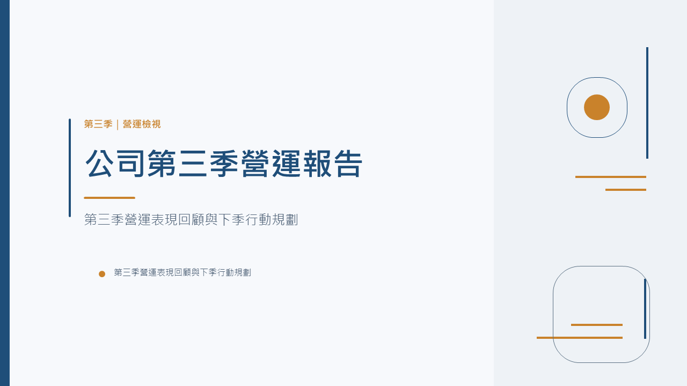
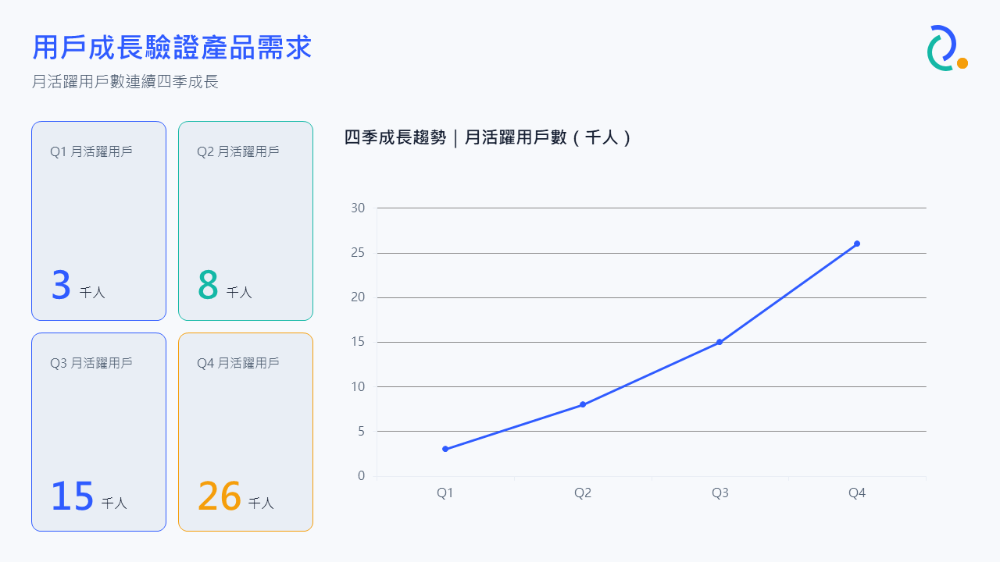
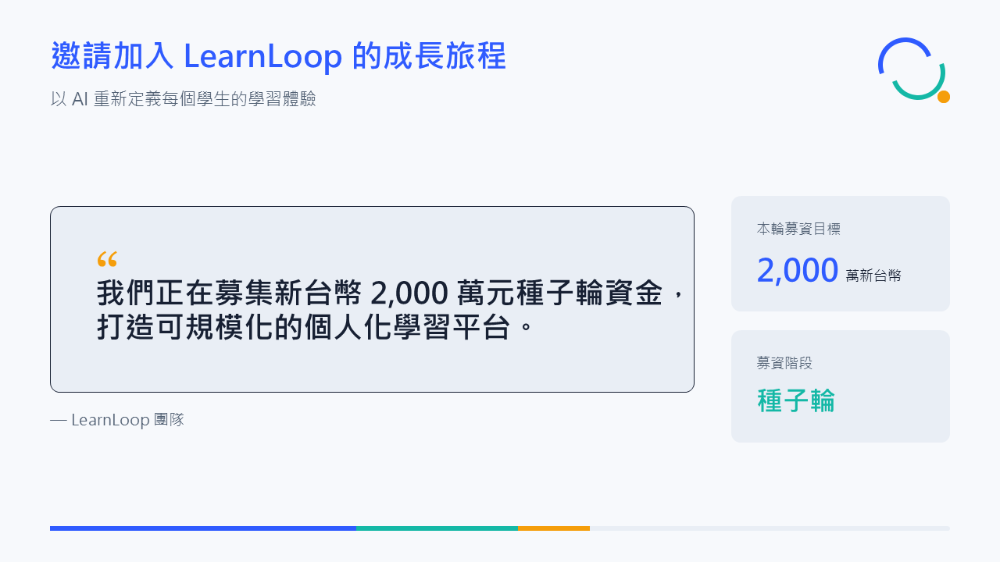
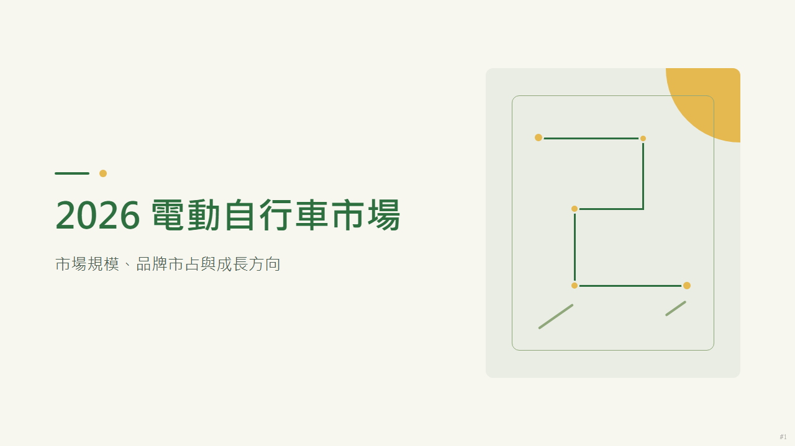
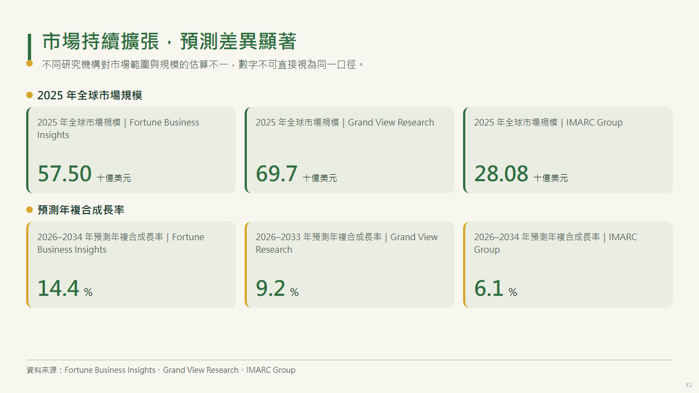
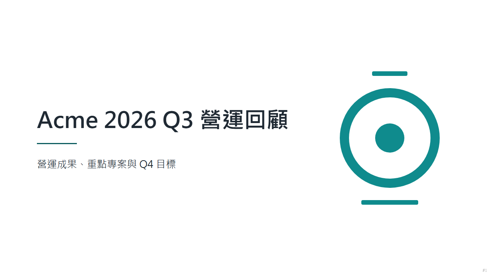
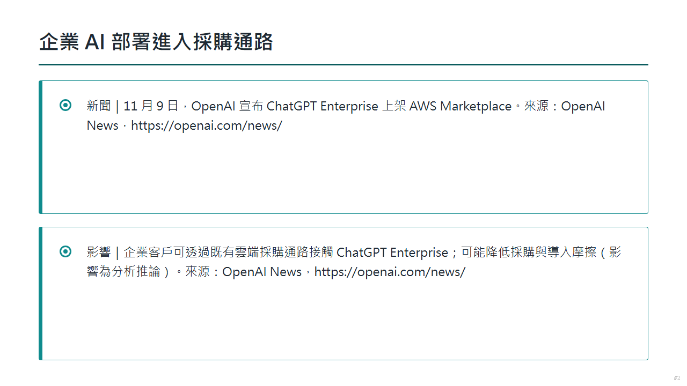

# pptx-agent

用 LLM 把一段簡報大綱轉成 `.pptx`,而且是可以在 PowerPoint 裡直接點選編輯的文字框/圖表,不是排版好之後截圖貼成圖片。

多數用 LLM 產生簡報的做法要嘛輸出「標題+條列」這種制式表單版面,要嘛把整頁畫面截圖貼成圖片換取版面自由度,但後者犧牲了可編輯性。這個專案把兩者拆開處理:先用瀏覽器排版 HTML/CSS 換取版面自由度,再用無頭瀏覽器讀出每個元素的座標、字體、顏色,轉譯成 PowerPoint 原生物件(文字框、形狀、圖片、圖表)。

## 流程

1. **Content Agent**(Python,Responses API)— 把大綱拆成每頁的結構化內容(標題/要點/數據/時間軸/引言),不碰版面與顏色。遇到近期新聞或即時資訊時會使用內建 Web Search 查證,並把來源名稱與網址寫進投影片內容。
2. **Design System Agent** — 產生一套配色/字型/間距/motif 的設計令牌,後面每一頁只能引用這套令牌,不能自己選色選字。
3. **HTML Layout Agent** — 依內容類型挑版型,用設計令牌寫成 HTML/CSS。這一步只是借用瀏覽器的排版能力,HTML 本身不是最終產出。
4. **Extract**(Node + Playwright)— 無頭瀏覽器渲染上一步的 HTML,對每個元素跑 `getBoundingClientRect()` / `getComputedStyle()`,把座標、字體、顏色萃取成一份 JSON(Slide Object Model)。
5. **Translate**(Node + pptxgenjs)— 依 Slide Object Model 產生 `.pptx`:文字變成 `addText`、色塊變成 `addShape`、有真實數字的數據頁變成原生 `addChart`,漸層/陰影/旋轉這類難以還原的裝飾元素才退回截圖疊圖層。
6. **Visual QA**(選用,迴圈)— 把產出的 `.pptx` 用 PowerPoint 實際渲染成截圖,讓模型對照原始內容檢查有沒有重疊、裁切、對比度不足這類客觀缺陷,有問題的頁面帶著具體修正指示重跑第 3-5 步。

每個階段之間交換的都是結構化 JSON,不是自然語言描述,任一階段都可以單獨重跑除錯。

## 防呆機制

寫 prompt 請 LLM 遵守規則不夠可靠,幾個容易出錯的地方額外加了程式檢查:

- 設計令牌產生後會跑一次 WCAG AA 對比度檢查(文字色對背景/卡片底色至少 4.5:1),不合格的顏色會被自動調整。
- 字型限制在 Windows/Office 內建清單(微軟正黑體等),避免瀏覽器預覽用的字型跟使用者電腦實際開啟時不同,導致換行/溢出跟預覽對不上。
- 萃取階段對旋轉過的裝飾元素(`transform: rotate(...)`)強制走截圖而非幾何轉譯——`getBoundingClientRect()` 回傳的是旋轉後的外接矩形,直接拿來當形狀座標會把一條細線畫成一大塊實心色塊。

## 畫面

同一套 pipeline,不同大綱會產生不同配色跟版型:


大綱提到 AI、募資這類關鍵字時,Design System Agent 傾向選深色調;換一份公司季報大綱,同一套 pipeline 會給出淺色商務風:



大綱裡有實際數字時,數據頁會產生原生 PowerPoint 圖表(可雙擊編輯內嵌資料),而不是畫出來的假圖表:



文字框在 PowerPoint 裡可以直接點選編輯:



### 指定簡報樣式

大綱裡直接寫出配色或風格(例如「森林綠與暖黃色,自然清新」),Design System Agent 會把它轉成設計令牌,後續每一頁都沿用:





### 套用設計系統

用 `--design-system` 指定設計系統資料夾(`README.md` + `tokens.json`)時,色彩 token 由程式鎖定,不會被 LLM 改動:





## 安裝

```bash
cp .env.example .env   # 填入下方三個環境變數
uv sync
cd node && npm install && npx playwright install chromium && cd ..
```

`.env` 需要三個變數(任何相容 OpenAI Responses API 的端點都可以):

| 變數 | 說明 |
|---|---|
| `AZURE_OPENAI_BASE_URL` | 例如 `https://YOUR-RESOURCE.openai.azure.com/openai/v1` |
| `AZURE_OPENAI_API_KEY` | API 金鑰(`.env` 已在 `.gitignore`,不要提交) |
| `AZURE_OPENAI_MODEL` | 部署名稱 / 模型名稱 |

> Windows 主控台若是非 UTF-8 編碼(例如繁中系統預設的 cp950),輸出中文進度訊息時可能出現 `UnicodeEncodeError`,執行前先設定 `PYTHONUTF8=1` 即可(PowerShell:`$env:PYTHONUTF8=1`)。

## 使用

```bash
uv run pptx-agent --outline "你的簡報大綱..." --slides 6
```

使用者若在大綱中指定色彩、特定物件/場景的色彩、材質或素材參考,Design Agent 可用 Web Search 查找色碼與圖片來源。也可選擇固定一套本機設計系統(資料夾需含 `README.md`、`tokens.json`,素材放在 `assets/`):

```bash
uv run pptx-agent --outline "金融業新聞簡報..." --slides 10 --design-system "./my-design-system"
```

### Web Search(查證與資料來源)

Content Agent 與 Design Agent 使用 Responses API 內建的 `web_search` 工具:

- 大綱涉及「最新、近期、新聞、目前狀態」時,Content Agent 會先查證再寫內容,並把來源名稱與網址寫進投影片。例如 `--outline "請查詢最新的 AI 產業新聞,做成本週新聞簡報..."`。
- 大綱指定色彩、物件/場景色彩或素材參考時,Design Agent 會查找色碼與圖片來源。
- 大綱沒有提供數據、也沒有要求查證時,模型可能產生「待提供」之類的佔位文字;需要真實數字請在大綱中給出,或明確要求查詢最新資料。

預設會一路跑完內容/設計/排版 → 幾何萃取 → 轉成 `.pptx` → 視覺 QA 迴圈 → 結構驗證 → 自動開啟。輸出在 `outputs/<timestamp>/`。

| 參數 | 說明 |
|---|---|
| `--outline-file <path>` | 大綱改用檔案輸入 |
| `--slides N` | 期望投影片張數(提示,非強制) |
| `--design-system <path>` | 選用設計系統資料夾;其規範會傳給 Design/Layout Agent,若有色彩 token 則由程式鎖定,`assets/` 會複製到輸出目錄供投影片引用 |
| `--qa-rounds N` | 視覺 QA 迴圈輪數,預設 1,`0` 關閉(僅 Windows + PowerPoint) |
| `--html-only` | 只做到 HTML 預覽,不轉成 `.pptx` |
| `--no-open-result` | 完成後不要自動開啟 |

不需要 LLM 的離線冒煙測試(手寫內容涵蓋所有圖表類型與選項):

```bash
uv run python scripts/demo_charts.py outputs/demo-charts
node node/build.js outputs/demo-charts
uv run python -m pptx_agent.validate outputs/demo-charts
```

單獨跑結構驗證:

```bash
uv run python -m pptx_agent.validate outputs/<timestamp>
```

檢查每頁都有可編輯文字框、非純文字視覺元素,以及頁數跟 `content.json` 一致。

## 專案結構

```
src/pptx_agent/
  agents/            content_agent / design_agent / layout_agent / qa_agent
  charts.py          data-chart 指令驗證(原生圖表的資料/類型/選項)
  color_contrast.py  WCAG 對比度計算與自動修正
  design_system.py   載入選用設計系統(README + tokens.json + assets/)
  fonts.py           字型安全清單
  pipeline.py        Content -> Design -> Layout -> deck.html
  pptx_render.py     PowerPoint COM 自動化,供視覺 QA 用
  validate.py        結構驗收檢查
  cli.py             `pptx-agent` 指令入口
node/
  extract.js         Playwright 幾何萃取
  translate.js       pptxgenjs 轉譯,含原生圖表
  lib/charts.js      原生圖表(折線/長條/圓環等)建構
scripts/
  demo_charts.py     離線圖表示範 / 冒煙測試
```

## 已知限制

- 視覺 QA 迴圈跟 PowerPoint COM 自動化只能在 Windows 上跑;沒有 PowerPoint 的環境會自動跳過這步,其餘流程不受影響。
- 文字框寬度會刻意放寬 12% 再排版,避免瀏覽器跟 PowerPoint 對中文字寬的量測差異造成裁切,代價是偶爾文字會貼近卡片邊緣。
- HTML 預覽(`deck.html`)不會畫出原生圖表,只顯示斜紋佔位框;圖表只在輸出的 `.pptx` 中呈現。
- Web Search 的結果品質取決於模型與搜尋結果;簡報中的數字與來源發佈前仍應人工核對,不同來源的口徑(市場範圍、預測年份)可能不一致。
- 漸層、陰影、SVG、旋轉過的裝飾元素一律轉成截圖疊圖層,不是原生可編輯物件。

## 需求

- Python 3.12+ / uv
- Node.js 20+ / npm
- Windows + PowerPoint(選用,視覺 QA 與人工檢查用)
